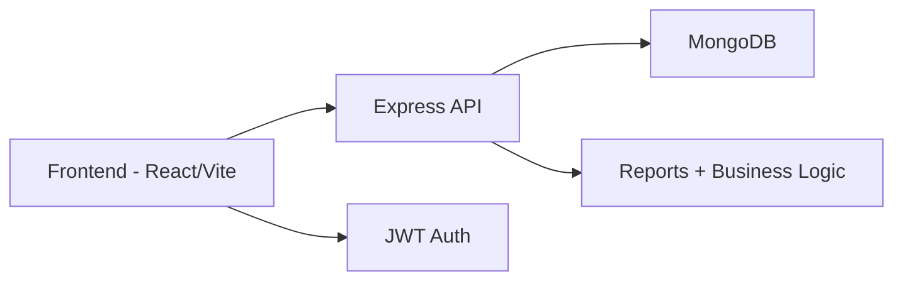

# Travel Booking and Itinerary Management Portal

A full-stack travel booking portal built with React + Vite on the frontend and Express + MongoDB on the backend. The app includes role-based access for admin, travel agent, customer, and service provider users with destination management, booking workflows, itinerary management, cancellations, reports, Docker support, and CI/CD workflow config.

## Problem statement
The project addresses the need for a unified platform to manage destinations, travel packages, bookings, services, itineraries, and analytical reports for a travel company. The portal enables users with different roles to operate within a secure, role-aware workflow while allowing customers to browse and book trips easily.

## Objectives
- Manage travel destinations and packages.
- Support booking lifecycle with payments and cancellations.
- Generate reports using aggregated data.
- Provide role-based access and secure authentication.
- Containerize and automate deployment setup.

## Architecture


## User roles
- Admin
- Travel Agent
- Customer
- Service Provider

## Demo credentials (in-memory fallback mode)
- Admin: admin@travelportal.com / admin123
- Agent: agent@travelportal.com / agent123
- Customer: customer@travelportal.com / customer123
- Provider: provider@travelportal.com / provider123

## Tech stack
- Frontend: React, Vite, React Router, Axios, Recharts, Lucide React
- Backend: Node.js, Express.js, MongoDB, Mongoose
- Testing: Jest, Supertest
- DevOps: Docker, Docker Compose, GitHub Actions

## Local setup
1. Create backend/.env from backend/.env.example.
2. Install dependencies:
   - `cd frontend && npm install`
   - `cd ../backend && npm install`
3. Start MongoDB locally or via Docker Compose.
4. Start backend: `cd backend && npm run dev`
5. Start frontend: `cd frontend && npm run dev`

When MongoDB is connected, authentication uses MongoDB users instead of these in-memory demo accounts. To create the first MongoDB admin, set `ADMIN_EMAIL` and a strong `ADMIN_PASSWORD` in the local environment and run `npm run create-admin` from `backend`. The command does not create demo catalog or booking records.

The customer destination and package pages read published records from MongoDB. To explicitly add the optional starter catalog, set `MONGO_URI` to the intended database, inspect it, then run `npm run seed:catalog` from `backend`. The seed command is never run by server startup, inserts only missing destination/package pairs, leaves existing records unchanged, and does not create bookings or payments. It requires `MONGO_URI` to be set explicitly.

## Docker setup
```bash
docker compose up --build
```

## Frontend commands
```bash
cd frontend
npm install
npm run dev
npm run build
```

## Backend commands
```bash
cd backend
npm install
npm run dev
npm run test
npm run seed:catalog
```

Run `npm run seed:catalog` only after confirming `MONGO_URI` points to the intended database. It is an optional one-time catalog insert, not a migration or automatic startup task.

## GitHub push commands
```bash
git init
git add .
git commit -m "Initial commit"
git branch -M main
git remote add origin <repository-url>
git push -u origin main
```

## Deployment guidance
- Use MongoDB Atlas for production database.
- Deploy frontend to Vercel or Netlify.
- Deploy backend to Render, Railway, or a VPS.
- Configure environment variables in the hosting platform.

## Testing
```bash
cd backend && npm test
cd frontend && npm run build
```

## API documentation
The backend exposes REST APIs under `/api` for auth, users, destinations, packages, services, bookings, itineraries, cancellations, payments, and reports.

## Notes
- Set strong JWT secrets in production.
- Do not commit real secrets or `.env` files.
- Authentication, destinations, packages, bookings, cancellations, payments, and reports use MongoDB when it is connected. Reports show empty-state totals when their collections are empty.
- Destinations and packages are published dynamically from MongoDB; admin catalog actions can create, edit, publish, unpublish, or archive records. Archiving preserves historical bookings.
- Customers can open personal reports beside Services in the navigation. The customer report endpoint is scoped to the signed-in customer and refreshes every 30 seconds; `/reports` remains restricted to administrators and travel agents.
- User management, services, and itineraries use MongoDB when connected; the API uses in-memory demo data only when MongoDB is unavailable in development.
- Booking creation records a pending payment; no payment gateway or verified charge/refund flow is integrated, so payments must not be marked paid manually.
- Production startup requires `MONGO_URI`, a `JWT_SECRET` of at least 32 characters, and `CLIENT_URL`. MongoDB connection failures stop production startup; demo mode is development-only.
